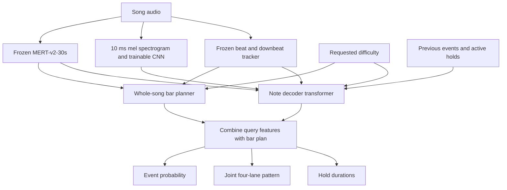

# Cadencia v1

Cadencia generates four-key osu!mania charts from music. It predicts **when an event happens, the complete four-lane tap/hold-start pattern, and hold lengths**. Charts can be played in a browser or exported to osu!.

Requires Python 3.12+, [uv](https://docs.astral.sh/uv/), and FFmpeg on `PATH`.

```sh
uv sync --extra placement --extra download --group dev
```

The repository includes a small, hash-verified **v1 inference bundle** in `model_releases/v1/`. It contains an explicit snapshot of the latest completed phrase-training weights at publication, the planner, chart-pretraining weights, and alignment prior. The manifest records the selected epoch, validation measurements, and source checkpoint hash. The large frozen MERT and beat-tracker weights download separately on first use. The model cards describe their licenses and requirements: [MERT-v2-30s](https://huggingface.co/m-a-p/MERT-v2-30s), [Beat This!](https://github.com/CPJKU/beat_this).

## Generate from a JSON file

Copy `examples/chart.json` and fill in the song and chart metadata:

```json
{
  "youtube_url": "https://www.youtube.com/watch?v=2SUwOgmvzK4",
  "title": "The Less I Know the Better",
  "artist": "Tame Impala",
  "author": "Cadencia",
  "version": "4K Generated",
  "difficulty": 2.0,
  "model_version": "v1",
  "output_dir": "../data/exports/example",
  "device": "cpu",
  "seed": 42,
  "beat_alignment": true,
  "constant_scroll": true
}
```

Paths are relative to the JSON file. Replace `youtube_url` with `audio_file` to use a local audio or music video file. Provide exactly one. `version` names the beatmap difficulty; `model_version` selects the trained model. Use `device: "cuda"` for GPU inference.

```sh
./build_chart.sh examples/chart.json
# With no argument, the wrapper uses data.json.
```

The pipeline runs the existing scripts to produce an MP3, a self-contained `.cadencia` chart with audio, and an `.osz` archive. It preserves generated notes: difficulty is a conditioning target, not a guaranteed star rating. There is no automatic note thinning. Constant scroll changes exported timing points without moving or removing notes.

Stages can be run separately. Existing outputs are never silently overwritten:

```sh
uv run scripts/build_chart.py examples/chart.json --stage audio
uv run scripts/build_chart.py examples/chart.json --stage chart
uv run scripts/build_chart.py examples/chart.json --stage export
```

Use `"checkpoint": "path/to/model.pt"` instead of `model_version` for custom weights.

## Python API and playback

```python
from cadencia.osumania import Simulator, SimulatorConfig, load_model

model = load_model("v1", device="cpu")
model.create_chart("song.mp3", out="song.cadencia", difficulty=2.0, seed=42)
Simulator("song.cadencia", port=6767, config=SimulatorConfig(), open_browser=False)
```

Open `http://localhost:6767`. The Simulator supports keyboard and touch play, configurable keybinds and tile speed, and fullscreen mode. It preloads the supplied chart and audio. Audio playback starts after user interaction.

Generate from local audio/video or convert a saved chart using the CLI:

```sh
uv run scripts/music_to_osz.py song.mp4 --difficulty 2 --out data/exports/song.osz
uv run scripts/convert_cadencia.py song.cadencia --out song.osz --constant-scroll
uv run scripts/run_simulator.py --song song.mp3 --difficulty 2 --port 6767
```

`convert_cadencia.py --target-stars` is a separate, explicitly requested simplification option that can remove notes. It is not used by the JSON pipeline or ordinary generation. Calculator ratings may differ from the game's displayed rating.

## Architecture



- **Audio:** frozen MERT-v2-30s produces 1,024-dimensional features at 25 Hz from overlapping audio chunks. The decoder reads two seconds of local features. A 64-band mel branch uses a 10 ms hop and a 101-frame local window, encoded by two temporal convolutions. Its usefulness relative to MERT alone still needs a controlled comparison.
- **Rhythm:** the frozen, checksum-pinned Beat This! `final0` model supplies beat/downbeat activations and a tracked timeline. Six rhythm features include beat/downbeat activation, audio onset strength, bar phase, and bar confidence. Tempo can vary. Tracking errors and ambiguous bar boundaries remain possible; this is not a time-signature classifier.
- **Planner:** a two-layer transformer looks across pooled audio/rhythm features for the song. For each bar it predicts rest probability, note heads per beat, chord fraction, and held-lane occupancy. It is trained separately, then frozen. Predicted plans guide the decoder; human plan targets are never decoder inputs.
- **Decoder:** two transformer layers, four attention heads, width 128, approximately 0.8 million parameters including the local audio branch and output heads. Up to 64 previous event groups and the current query attend to local audio memory. Difficulty, local tempo, beat information, and active holds also condition predictions.
- **Outputs:** event probability at every 10 ms step; one of 80 nonempty joint four-lane patterns; four hold-duration predictions in beats. Each lane can be empty, a tap, or a hold start. Hold releases are scheduled from duration and fed back into history. Occupancy constraints prevent same-lane conflicts.

Generation uses its own accepted predictions as history. Optional post-generation beat alignment makes conservative timing adjustments, normally within 25 ms, using an empirical training-only phase prior plus acoustic onset evidence. Chords move together and hold durations are preserved. Alignment cannot fix large timing errors or guarantee the beat tracker is correct.

Optional repeated-section reuse is available through `--repeat-sections --repeat-variation 0.2`. It matches similar eight-bar audio windows and transfers patterns with some bars retaining their original output. It is disabled by default and is not a learned chorus-reference input to the decoder.

## Data

The existing local corpus contains **1,001 ranked four-key charts**: 795 training, 99 validation, and 107 test charts. These are chart counts, not unique-song counts. Difficulties sharing a beatmapset or identical audio stay in the same split.

The placement dataset stores:

- A regular 100 Hz timeline with tap/hold-start labels for all four lanes, hold durations, active holds, and reference timing information.
- Difficulty in osu!mania star ratings, not the `.osu` OverallDifficulty setting.
- Shared frozen MERT features, local mel matrices, and audio-predicted rhythm sidecars.
- Source identities, checksums, and split assignments for reproducible preprocessing.

Original chart timing defines the training labels. Audio-predicted rhythm features condition the network, avoiding direct use of human chart timing as a substitute for beat tracking at inference.

### Download and preprocess charts

```sh
uv run scripts/download_ranked_mania.py --count 100
```

The script selects individual ranked four-key difficulties and logs/skips chart-specific failures until the requested number succeeds. Reruns reuse cached charts and archives. The library itself does not silently filter key counts.

```python
from cadencia.osumania import HinamizawaClient, load_chart

client = HinamizawaClient(data_dir="data")
page = client.get_ranked_mania({"limit": 25, "page": 0})
charts = client.download_charts({
    "urls": ["https://osu.ppy.sh/beatmapsets/2043161#mania/4855704"]
})
chart = load_chart(url=charts[0].metadata["source_url"])
```

`load_chart` reads local preprocessed data immediately using exactly one of `name=` or `url=`. It never downloads and raises `FileNotFoundError` if missing. Missing standalone audio, including keysound-only maps, raises `MissingChartAudioError`. Audio decoding falls back from SoundFile to FFmpeg when needed.

### Build the placement dataset

```sh
uv run scripts/make_placement_dataset.py --encoder mert-v2-30s \
  --high-resolution --fetch-difficulties --device cuda \
  --output data/placement_dataset_v1
```

This reads existing `data/osumania/charts/*/trace.json` files, caches audio features, and requantizes original notes to the 10 ms grid. It does not redownload charts. Star ratings use explicit labels, checksum-bound cached values, a local calculator, or official metadata as available. Existing output datasets are not overwritten.

## Training

Training consists of chart-sequence pretraining, bar-planner training, audio-conditioned initialization, and phrase-window fine-tuning. GPU examples:

```sh
uv run scripts/pretrain_charts.py --data data/placement_dataset_v1 \
  --device cuda --amp --epochs 10 --output data/chart_pretraining.pt
uv run scripts/train_bar_planner.py --data data/placement_dataset_v1 \
  --device cuda --epochs 50 --output data/bar_planner_v1.pt
uv run scripts/train_intervals.py --data data/placement_dataset_v1 \
  --planner data/bar_planner_v1.pt --chart-pretraining data/chart_pretraining.pt \
  --device cuda --amp --epochs 50 --output data/audio_decoder_v1.pt
uv run scripts/train_phrases.py --data data/placement_dataset_v1 \
  --planner data/bar_planner_v1.pt --initialize data/audio_decoder_v1.pt \
  --device cuda --amp --epochs 50 --output data/decoder_v1.pt
```

Chart pretraining predicts the next onset's beat gap, joint pattern, and hold lengths without audio. Compatible history, attention, conditioning, pattern, and duration weights initialize the audio decoder; audio-facing layers start fresh. MERT and the trained planner stay frozen during audio training; the decoder and mel branch learn.

Phrase training keeps whole four-beat windows and mixes windows until each batch has at least 128 sampled query rows. Every onset and nearby empty row is retained; 10% of distant empty rows are resampled. Timing is inverse-probability weighted over the fixed original grid size. Placement is averaged over onset groups, duration over hold starts, and phrase loss over within-window transitions. Phrase/chart boundaries never create artificial transitions.

The objective is timing BCE + joint-pattern cross-entropy + hold-duration Smooth L1 + up to **0.05 × phrase-transition JS divergence**, ramped up over three epochs. The last term compares expected versus human adjacent joint-pattern transitions in three beat-gap buckets. It is differentiable, but measures local transition statistics at known human onset positions rather than full generated-phrase quality. Hold endings retain their separate duration objective. `--phrase-weight 0` provides a matched batching control.

Training uses human history; generation uses predicted history. Validation metrics therefore do not establish complete-chart playability. Phrase comparisons and playtesting complement per-note precision, recall, and F1.

### Checkpoints and resume

- `data/decoder_v1.pt`: protected best-validation inference weights, including the starting checkpoint if no epoch improves the shared base loss.
- `data/decoder_v1.last.pt`: most recent completed epoch, including `last_model`, optimizer, scheduler, RNG, and training history.
- `data/decoder_v1.metrics.json`: per-epoch training and validation measurements.

Files are replaced atomically after each epoch. They are rolling checkpoints, not one file per epoch. The generation loader uses `model`, so passing a training `.last.pt` still selects its protected best weights. Publish with `--weights last` to explicitly export the latest trained weights instead.

```sh
uv run scripts/train_phrases.py --data data/placement_dataset_v1 \
  --planner data/bar_planner_v1.pt --resume data/decoder_v1.last.pt \
  --output data/decoder_v1.pt --device cuda --amp --epochs 75
```

`--epochs` is the total target. Initialization uses fresh optimizer state; resume restores it. Dataset, planner, configuration, sampling recipe, and prior must match.

### Publish another model snapshot

Published bundles are immutable. Choose a new release name:

```sh
uv run scripts/register_model_release.py v1.1.0 \
  --decoder data/decoder_v1.last.pt --weights last \
  --planner data/bar_planner_v1.pt --chart-pretraining data/chart_pretraining.pt
```

The publisher checks component provenance, extracts the requested weights, excludes resumable state, and records hashes. Default `--weights best` exports the protected best checkpoint. Publishing is an explicit selection, not a claim that the selected epoch is objectively better.

## Evaluation and analysis

```sh
uv run scripts/evaluate_phrases.py --generated generated.cadencia \
  --dataset data/placement_dataset_v1 --split test --out data/analysis/phrases.json
uv run scripts/profile_beat_offsets.py --data data/placement_dataset_v1 \
  --split train --out data/analysis/beat_offsets
```

Phrase evaluation compares rhythm, chord/hold, and lane patterns over several beat-window lengths. Corpus resemblance is not same-song accuracy. `--paired` uses a matching human chart's timeline; the recording identity must be checked separately. Keep test data reserved for final reporting, and use validation data to choose model changes.

## Development

All command-line scripts live in `scripts/`. Data, feature caches, generated charts, and live training checkpoints stay under ignored `data/`. The released v1 inference bundle is tracked separately so a clone contains the exact generation weights.

```sh
uv run pytest -q
```

The low-level `Chart`, local loader, timeline viewer, audio analysis, and earlier checkpoint-format readers remain available. Experimental baseline training tools are retained in `scripts/`; the workflow above is the supported v1 path.
